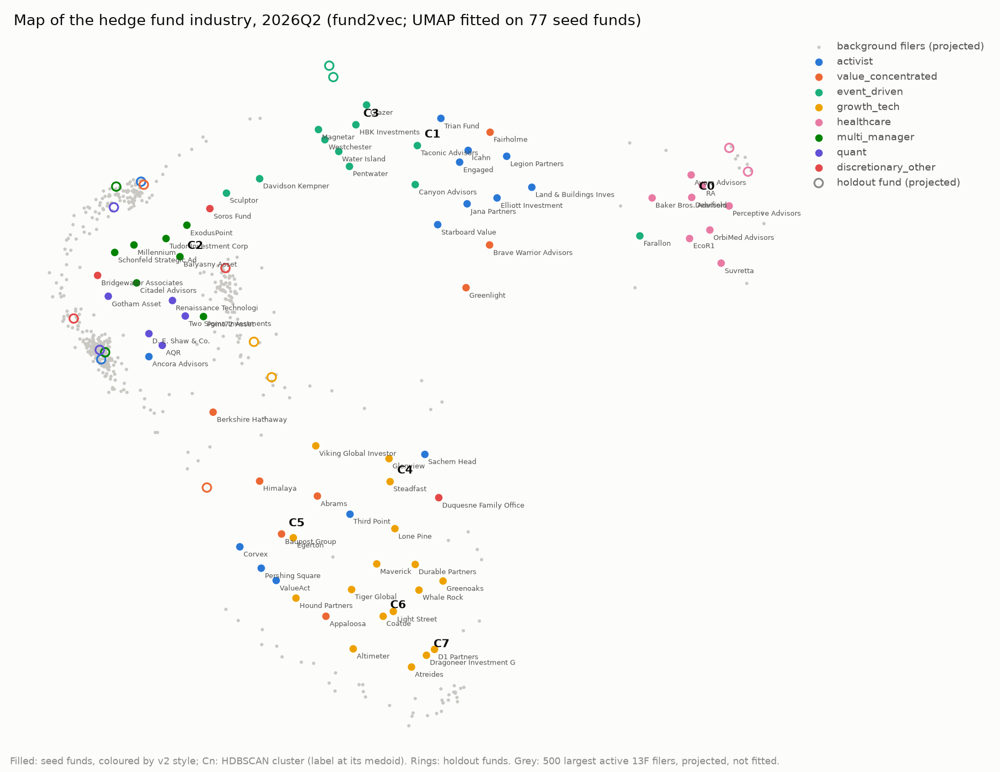
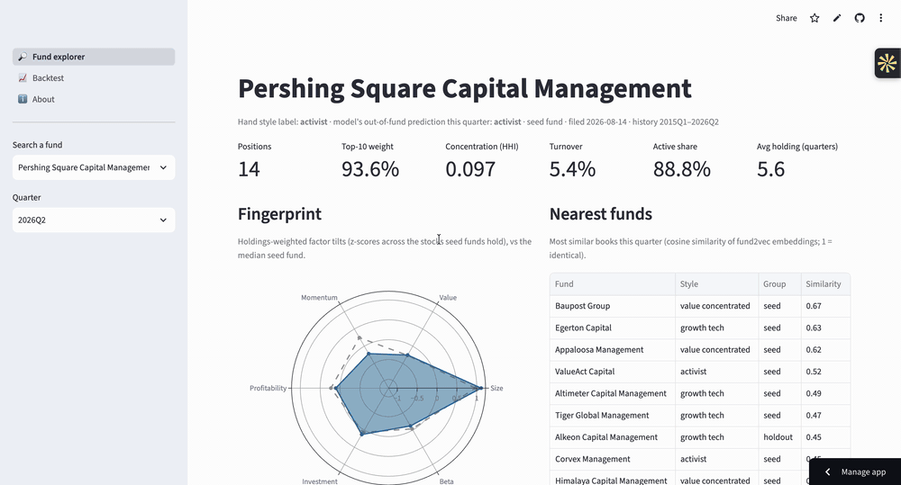

**Live app:** https://reverse-engineer-hedge-funds.streamlit.app/ (free hosting: it sleeps when idle and takes about 30 seconds to wake)

# Reverse-engineer a hedge fund

Hedge funds publish their long US stock positions every quarter in SEC 13F filings, 45 days late.
This project turns 11 years of those filings for 93 funds into a strategy fingerprint per fund, a map of who trades alike, and next-quarter predictions.
It then asks whether any of it makes money once you trade only on what was public, and answers honestly: mostly not.



*fund2vec embeddings of each fund's book, 2026Q2, UMAP fitted on the 77 seed funds, coloured by HDBSCAN cluster; holdout funds and large background filers projected in. Reading: [`docs/fund_map.md`](docs/fund_map.md).*



*26-second tour of the [live app](https://reverse-engineer-hedge-funds.streamlit.app/): a fund's fingerprint, nearest funds and place on the map, its predicted next moves, then the backtest.*

## Results

All numbers are out of sample. Models were tuned on 2022 and scored once on 2023Q1–2026Q1, and every
feature uses only filings that were public on the prediction date (a 16-check leakage audit enforces this).

| Task | Model | Baseline | Model result | Baseline result |
|---|---|---|---|---|
| **A. Style** from holdings (8 styles), 16 hand-labelled funds never trained on | LightGBM on fingerprint + 13D activity | majority class | macro-F1 **0.58** (accuracy 0.63) | macro-F1 0.05 |
| **C1. Next move** on each position (exit / trim / hold / add), 488k test positions | LightGBM + peer and cluster features | fund's own last-quarter action rates | macro-F1 **0.487**, log-loss 1.124, exit AUC 0.80 | 0.380, 1.267, 0.69 |
| **C2. New buys**, top 20 per fund-quarter, 893 test fund-quarters | ALS collaborative filtering | re-entry (names sold in the last year) | NDCG@20 0.156 | **0.164** |
| **D. Backtest**, consensus best ideas, 2018–2026, 10 bp per side | trade the day after the filing deadline | SPY | 9.3%/yr, Sharpe 0.40, FF6 alpha −1.8% (t −0.7) | 14.5%/yr, Sharpe 0.66 |
| **D. Backtest**, frozen C2 new-buy list, 2023–2026 | ALS top names across funds | SPY | 24.1%/yr, Sharpe 0.96, FF6 alpha +4.3% (t 0.9) | 21.9%/yr, Sharpe 1.10 |

Takeaways:
- **The style classifier works** on funds it never saw.
- **Next moves are predictable** well beyond a fund's own habits. But herding signals from peers and clusters add almost nothing: log-loss improves by 0.0035.
- **Most predictable new buys are funds returning to names they recently sold.**
- **No clone or model strategy earns a significant factor alpha** after the disclosure lag.

Details: [`docs/style_classifier.md`](docs/style_classifier.md), [`docs/task_c_results.md`](docs/task_c_results.md), [`docs/backtest.md`](docs/backtest.md). The story of the decisions, the leaks caught and what didn't work: [`docs/writeup.md`](docs/writeup.md). Every design choice: [`docs/decisions.md`](docs/decisions.md).

## Further analyses

- **Is 13F news priced in? Mostly yes** ([`docs/event_study.md`](docs/event_study.md)). The study covers 290,724 new positions, timed by each filing's EDGAR acceptance time.
  - There is no run-up before disclosure.
  - New positions beat SPY by +0.4% (fund-weighted, t = 4.0) over the first two trading days, but the median position doesn't move.
  - Over the next 50 trading days they lag SPY by about 1%. A copycat buying after the filing earns nothing.
- **Clone the best funds: more return, no alpha** ([`docs/clone_strategy.md`](docs/clone_strategy.md)).
  - The strategy copies the top 5 positions of the ten funds with the best trailing three-year 13F returns, bought the day after each fund's filing. Its rules were fixed on 2018–2022 and committed before the single 2023+ run.
  - It returned 27.5% a year against 21.9% for SPY, but with the same Sharpe (1.09 vs 1.10) and a beta of 1.16.
  - The FF5+momentum alpha is +1.5% (t = 0.3): the winners' growth tilt, not harvestable skill.
- **Crowded now** ([`docs/crowding_now.md`](docs/crowding_now.md), app page "Crowded now"). In the 2026Q2 filings (as of 2026-08-17), AMZN, GOOGL, NVDA, META and TSM have the most conviction holders (33 to 17 seed funds each). 15 of the top 20 are crowded inside one cluster, mostly the multi-manager and growth/tech groups, plus a merger-arbitrage cluster in EA, WBD and NSC. In past episodes crowding flagged risk in the 2021–22 growth unwind but not in the COVID crash. The list says where selling would be correlated, not what will fall.

## Live forward test

Each quarter the frozen models (trained on 2018–2022, never retuned) predict every seed fund's next moves from its newest 13F filing. The forecast is committed and tagged before the next filings come out, then graded against them: [live track record](https://reverse-engineer-hedge-funds.streamlit.app/), `predictions/scorecard.csv`.

```bash
uv run python -m src.live.quarter 2026Q3   # after the Sep–Nov 2026 13F data set is out, before 2026-12-31
```

The command grades the previous forecast, issues the new one, and commits, tags and pushes `predictions/` only. Rules are in [`src/live/quarter.py`](src/live/quarter.py) and [`docs/decisions.md`](docs/decisions.md).

## Data and its limits

- **Sources:**
  - SEC 13F data sets, 2015Q1–2026Q2: 77 seed funds plus 16 hand-labelled holdout funds, each quarter read from its *original* filing.
  - EDGAR full-index filings: 13D, Form 25/15, merger proxies.
  - SEC XBRL fundamentals.
  - OpenFIGI for CUSIP mapping.
  - Yahoo daily prices.
  - Kenneth French's factors.
- **13F shows only long positions in US-listed stocks and listed options,** as quarter-end snapshots. No shorts, bonds, futures, FX, non-US stocks or intra-quarter trades, so a long/short fund's net exposure is unknown. Funds can delay disclosing positions (confidential treatment). That matters most for merger-arbitrage funds, whose deal positions often appear months later in amendments, which this project deliberately ignores.
- **Yahoo has no price at all for delisted stocks.** About 10–34% of seed weight (more in early years) uses returns inferred from the funds' own reported values or from SEC deal terms ([`docs/delisting_returns.md`](docs/delisting_returns.md)). Those are quarterly, so backtest timing for those names is approximate.
- **Style labels are hand-assigned judgement calls** for 93 funds. The seed list is a curated set of well-known funds, not a random sample of filers.

## How to run

```bash
uv sync
cp .env.example .env    # add your name and email: the SEC requires a User-Agent
```

**The app** reads only the committed snapshot in `app/data/` (4.6 MB):

```bash
uv run streamlit run app/streamlit_app.py
```

To deploy on Streamlit Community Cloud, point it at `app/streamlit_app.py`; it installs `app/requirements.txt` only.

**The full pipeline** rebuilds everything from SEC downloads. It takes many hours, mostly Yahoo rate limits and SEC downloads, and every download is cached under `data/raw/`. Run in order:

```bash
# Milestones 1-2: filings, securities, prices, fundamentals
uv run python -m src.ingest.download --start 2025Q3 --end 2026Q2
uv run python -m src.ingest.load
uv run python -m src.ingest.backfill --start 2015Q1 --end 2025Q2
uv run python -m src.ingest.backfill --holdout --start 2020Q1 --end 2025Q2
uv run python -m src.securities.universe
uv run python -m src.securities.cusip_map            # faster with OPENFIGI_API_KEY
uv run python -m src.securities.prices --start 2014-01-01 --slow
uv run python -m src.securities.fundamentals
uv run python -m src.securities.factors
uv run python -m src.securities.stock_quarter
# Milestone 3: features
uv run python -m src.features.books
uv run python -m src.features.positions
uv run python -m src.features.fund_quarter
# Milestone 4: fingerprint, style, factor regressions
uv run python -m src.features.fingerprint
uv run python -m src.features.activist_13d
uv run python -m src.models.style_classifier
uv run python -m src.models.style_drift
# delisting gap: filled returns and labels
uv run python -m src.securities.implied_prices
uv run python -m src.securities.sec_events
uv run python -m src.securities.delistings --fetch
uv run python -m src.securities.labels
uv run python -m src.features.position_moves
uv run python -m src.features.merger_targets
uv run python -m src.models.factor_regressions
# Milestone 5: embeddings and clusters
uv run python -m src.features.embeddings
uv run python -m src.models.clustering select        # picks the method on pre-2023 data only
uv run python -m src.models.clustering
uv run python -m src.models.crowding
# Milestone 6: next-quarter moves
uv run python -m src.features.task_c
uv run python -m src.models.task_c2 baselines
uv run python -m src.models.task_c_baselines         # baselines written before any model
uv run python -m src.models.task_c1
uv run python -m src.models.task_c2 run
uv run python -m src.models.task_c_report
uv run python -m src.models.leakage_audit
# Milestone 7: backtest
uv run python -m src.backtest.signals
uv run python -m src.backtest.run
# Milestone 8: app snapshot
uv run python -m src.app_export
uv run pytest
```

## Layout

- `src/ingest`: SEC downloads and 13F parsing.
- `src/securities`: CUSIP mapping, prices, fundamentals, delisting returns.
- `src/features`: point-in-time features.
- `src/models`: Tasks A–C.
- `src/backtest`: Task D.
- `app/`: the Streamlit app and its snapshot.
- `docs/`: the plan, decision log, reports and figures.
- `tests/`: data-quality and unit tests.
