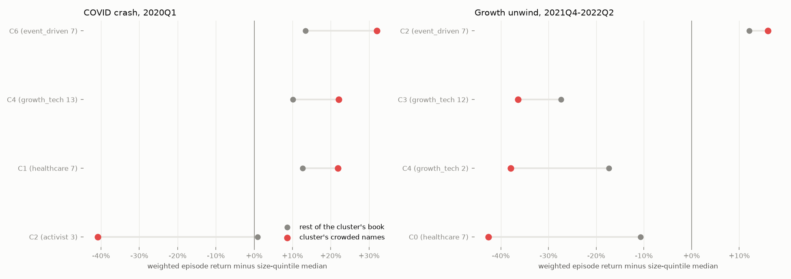
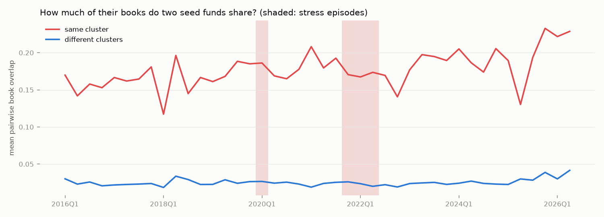

# Crowding in two stress episodes (Milestone 5, Task B)

Generated by `src/models/crowding.py` (definitions in its docstring). Reading:
`docs/fund_map.md`. A stock is **crowded in a cluster** if at least 3 funds
of one cluster, and at least 50% of its members, hold it. Returns
start at the book's quarter end; `ret_adj` subtracts the median return of the
stock's size quintile.

## Sensitivity to the conviction floor (main: 1%)

| episode | floor | n_crowded | n_widely_held | crowded_mean_ret | crowded_mean_ret_adj | crowded_median_ret_adj | reg_crowded | t_crowded |
|---|---|---|---|---|---|---|---|---|
| covid | 0.5% | 20 | 171 | -0.14 | 0.16 | 0.25 | 0.13 | 1.79 |
| covid | 1.0% | 13 | 92 | -0.07 | 0.20 | 0.25 | 0.11 | 1.53 |
| covid | 2.0% | 9 | 51 | -0.10 | 0.16 | 0.24 | 0.09 | 0.97 |
| growth | 0.5% | 25 | 160 | -0.29 | -0.11 | -0.03 | -0.15 | -1.90 |
| growth | 1.0% | 18 | 92 | -0.38 | -0.20 | -0.28 | -0.23 | -2.55 |
| growth | 2.0% | 7 | 50 | -0.45 | -0.29 | -0.36 | -0.13 | -1.34 |

## Overlap through time

Within-cluster overlap going in, as a percentile of all quarters 2016Q1-2026Q2:
covid (2019Q4) 62%, growth (2021Q3) 76%.

| quarter | within | across | all_pairs |
|---|---|---|---|
| 2019Q1 | 0.16 | 0.02 | 0.04 |
| 2019Q2 | 0.17 | 0.03 | 0.04 |
| 2019Q3 | 0.19 | 0.02 | 0.04 |
| 2019Q4 | 0.19 | 0.03 | 0.04 |
| 2020Q1 | 0.19 | 0.03 | 0.05 |
| 2020Q2 | 0.17 | 0.02 | 0.04 |
| 2020Q3 | 0.16 | 0.03 | 0.04 |
| 2020Q4 | 0.18 | 0.02 | 0.04 |
| 2021Q1 | 0.21 | 0.02 | 0.04 |
| 2021Q2 | 0.18 | 0.02 | 0.04 |
| 2021Q3 | 0.19 | 0.03 | 0.04 |
| 2021Q4 | 0.17 | 0.03 | 0.04 |
| 2022Q1 | 0.17 | 0.02 | 0.04 |
| 2022Q2 | 0.17 | 0.02 | 0.03 |
| 2022Q3 | 0.17 | 0.02 | 0.03 |
| 2022Q4 | 0.14 | 0.02 | 0.03 |

## COVID crash, 2020Q1 (book 2019Q4, fund2vec clusters)

57 of 76 seed funds in 7 clusters
(the rest are noise). 3806 common/ADR issuers with an episode return
(47 dropped for a missing return); 13 crowded in a cluster.

### Returns by crowding bucket

| bucket | n | mean_ret | median_ret | mean_ret_adj | median_ret_adj |
|---|---|---|---|---|---|
| 0-2 conviction holders | 3701 | -0.29 | -0.32 | 0.02 | -0.00 |
| crowded in a cluster | 13 | -0.07 | -0.02 | 0.20 | 0.25 |
| widely held, not crowded | 92 | -0.23 | -0.19 | 0.05 | 0.05 |

### Regression: episode return on crowding and characteristics (White t-stats)

| term | coef | t | n | r2 |
|---|---|---|---|---|
| intercept | -0.23 | -7.77 | 2347 | 0.04 |
| crowded | 0.11 | 1.53 | 2347 | 0.04 |
| log_n_holders | 0.06 | 4.45 | 2347 | 0.04 |
| log_me | -0.00 | -0.03 | 2347 | 0.04 |
| beta | -0.08 | -7.82 | 2347 | 0.04 |
| mom_12_1 | 0.03 | 2.10 | 2347 | 0.04 |

### Clusters going in

| cluster | n | styles | within_overlap | n_crowded | book_in_crowded | crowded_ret_adj | other_ret_adj | book_ret | crowded names (episode return) |
|---|---|---|---|---|---|---|---|---|---|
| C0 | 3 | activist 2, value_concentrated 1 | 0.05 | 0 | 0.00 | None | -0.02 | -0.29 |  |
| C1 | 8 | healthcare 7, event_driven 1 | 0.09 | 3 | 0.08 | 0.22 | 0.13 | -0.17 | ASND (-19%), ARVN (-2%), IOVA (+8%) |
| C2 | 5 | activist 3, discretionary_other 1, event_driven 1 | 0.04 | 1 | 0.12 | -0.41 | 0.01 | -0.33 | MGM (-64%) |
| C3 | 3 | discretionary_other 1, activist 1, growth_tech 1 | 0.23 | 0 | 0.00 | None | 0.11 | -0.18 |  |
| C4 | 18 | growth_tech 13, event_driven 2, healthcare 1, value_concentrated 1, discretionary_other 1 | 0.17 | 7 | 0.27 | 0.22 | 0.10 | -0.13 | META (-19%), BABA (-8%), AMZN (+6%), MSFT (+0%), NFLX (+16%), CRM (-11%) |
| C5 | 13 | multi_manager 7, quant 5, activist 1 | 0.28 | 0 | 0.00 | None | 0.02 | -0.25 |  |
| C6 | 7 | event_driven 7 | 0.16 | 2 | 0.05 | 0.32 | 0.13 | -0.16 | 2078185D (-3%), LPT (+5%) |

Members: **C0** Brave Warrior Advisors, Pershing Square, ValueAct; **C1** Avoro Advisors, Baker Bros. Advisors, Deerfield, EcoR1, Farallon, OrbiMed Advisors, Perceptive Advisors, RA; **C2** Canyon Advisors, Corvex, Elliott Investment, Land & Buildings Investment, Soros Fund; **C3** Bridgewater Associates, Durable Partners, Starboard Value; **C4** Altimeter, Appaloosa, Atreides, Coatue, D1 Partners, Dragoneer Investment Group, Duquesne Family Office, Egerton, Light Street, Lone Pine, Sculptor, Steadfast, Suvretta, Taconic Advisors, Tiger Global, Tybourne, Viking Global Investors, Whale Rock; **C5** AQR, Ancora Advisors, Balyasny Asset, Citadel Advisors, D. E. Shaw & Co., ExodusPoint, Gotham Asset, Millennium, Point72 Asset, Renaissance Technologies, Schonfeld Strategic Advisors, Tudor Investment Corp, Two Sigma Investments; **C6** Davidson Kempner, Glazer, HBK Investments, Magnetar, Pentwater, Water Island, Westchester

### Did they leave together? Actions by the next filing

| position | n | exit | trim | hold | add |
|---|---|---|---|---|---|
| other position | 1064 | 0.20 | 0.27 | 0.31 | 0.22 |
| own cluster's crowded name | 105 | 0.11 | 0.31 | 0.35 | 0.22 |

## Growth unwind, 2021Q4-2022Q2 (book 2021Q3, fund2vec clusters)

45 of 77 seed funds in 5 clusters
(the rest are noise). 4615 common/ADR issuers with an episode return
(204 dropped for a missing return); 18 crowded in a cluster.

### Returns by crowding bucket

| bucket | n | mean_ret | median_ret | mean_ret_adj | median_ret_adj |
|---|---|---|---|---|---|
| 0-2 conviction holders | 4505 | -0.22 | -0.19 | -0.03 | 0.00 |
| crowded in a cluster | 18 | -0.38 | -0.44 | -0.20 | -0.28 |
| widely held, not crowded | 92 | -0.30 | -0.28 | -0.12 | -0.12 |

### Regression: episode return on crowding and characteristics (White t-stats)

| term | coef | t | n | r2 |
|---|---|---|---|---|
| intercept | -0.06 | -2.33 | 2721 | 0.07 |
| crowded | -0.23 | -2.55 | 2721 | 0.07 |
| log_n_holders | -0.05 | -2.93 | 2721 | 0.07 |
| log_me | 0.01 | 1.59 | 2721 | 0.07 |
| beta | -0.12 | -12.53 | 2721 | 0.07 |
| mom_12_1 | -0.03 | -10.94 | 2721 | 0.07 |

### Clusters going in

| cluster | n | styles | within_overlap | n_crowded | book_in_crowded | crowded_ret_adj | other_ret_adj | book_ret | crowded names (episode return) |
|---|---|---|---|---|---|---|---|---|---|
| C0 | 9 | healthcare 7, activist 2 | 0.05 | 1 | 0.03 | -0.43 | -0.11 | -0.31 | MRTX (-62%) |
| C1 | 14 | multi_manager 7, quant 5, activist 1, discretionary_other 1 | 0.26 | 0 | 0.00 | None | 0.04 | -0.14 |  |
| C2 | 7 | event_driven 7 | 0.18 | 6 | 0.19 | 0.16 | 0.12 | -0.06 | 2499073D (-23%), KSU (+0%), PPD (+2%), NUAN (+2%), HRC (+4%), 2150994D (+6%) |
| C3 | 12 | growth_tech 12 | 0.18 | 10 | 0.29 | -0.36 | -0.27 | -0.47 | META (-52%), AMZN (-35%), SHOP (-77%), MSFT (-8%), PTON (-89%), SNOW (-54%) |
| C4 | 3 | growth_tech 2, discretionary_other 1 | 0.26 | 1 | 0.41 | -0.38 | -0.17 | -0.43 | CPNG (-54%) |

Members: **C0** Avoro Advisors, Baker Bros. Advisors, Deerfield, EcoR1, Jana Partners, Legion Partners, OrbiMed Advisors, Perceptive Advisors, RA; **C1** AQR, Ancora Advisors, Balyasny Asset, Bridgewater Associates, Citadel Advisors, D. E. Shaw & Co., ExodusPoint, Gotham Asset, Millennium, Point72 Asset, Renaissance Technologies, Schonfeld Strategic Advisors, Tudor Investment Corp, Two Sigma Investments; **C2** Glazer, HBK Investments, Magnetar, Pentwater, Taconic Advisors, Water Island, Westchester; **C3** Altimeter, Atreides, Coatue, D1 Partners, Dragoneer Investment Group, Egerton, Light Street, Lone Pine, Steadfast, Tiger Global, Tybourne, Whale Rock; **C4** Duquesne Family Office, Greenoaks, Maverick

### Did they leave together? Actions by the next filing

| position | n | exit | trim | hold | add |
|---|---|---|---|---|---|
| other position | 1167 | 0.16 | 0.26 | 0.42 | 0.15 |
| own cluster's crowded name | 107 | 0.21 | 0.25 | 0.38 | 0.15 |
