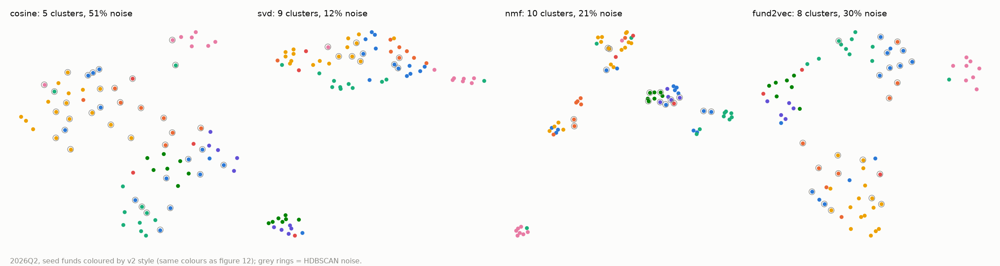
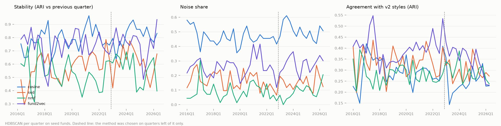
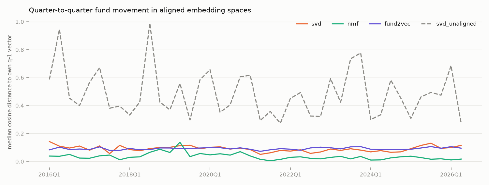

# Fund embeddings and clusters (Milestone 5, Task B)

Generated by `src/features/embeddings.py` and `src/models/clustering.py`. Design
choices are in the module docstrings and `docs/decisions.md`; the reading is in
`docs/fund_map.md`.

**Main method: `fund2vec`**, chosen on 2016Q1-2022Q4 only
(economic check to 2021Q4) at 2026-10-16T19:26:57, before any 2023+
metric was computed (`data/reference/embedding_choice.json`). Rule: rank sum of mean stability_ari, label_ari, econ_gap (HDBSCAN), ties to lower noise.

## Selection quarters (2016Q1-2022Q4), all metrics are quarterly means

| method | algo | n_clusters | noise_share | purity | purity_random | label_ari | stability_ari | econ_gap |
|---|---|---|---|---|---|---|---|---|
| cosine | hdbscan | 4.54 | 0.46 | 0.73 | 0.33 | 0.30 | 0.78 | 0.54 |
| fund2vec | hdbscan | 6.54 | 0.26 | 0.73 | 0.33 | 0.40 | 0.74 | 0.45 |
| nmf | hdbscan | 11.18 | 0.09 | 0.68 | 0.37 | 0.28 | 0.53 | 0.41 |
| svd | hdbscan | 9.21 | 0.16 | 0.71 | 0.36 | 0.34 | 0.57 | 0.43 |
| cosine | kmeans | 8.00 | 0.00 | 0.59 | 0.32 | 0.28 | 0.41 | 0.27 |
| fund2vec | kmeans | 8.00 | 0.00 | 0.67 | 0.33 | 0.38 | 0.63 | 0.38 |
| nmf | kmeans | 8.00 | 0.00 | 0.62 | 0.33 | 0.31 | 0.55 | 0.35 |
| svd | kmeans | 8.00 | 0.00 | 0.66 | 0.33 | 0.36 | 0.56 | 0.34 |

## 2023Q1-2026Q2 (after the choice)

| method | algo | n_clusters | noise_share | purity | purity_random | label_ari | stability_ari | econ_gap |
|---|---|---|---|---|---|---|---|---|
| cosine | hdbscan | 4.64 | 0.51 | 0.74 | 0.34 | 0.25 | 0.81 | 0.54 |
| fund2vec | hdbscan | 7.29 | 0.28 | 0.74 | 0.35 | 0.35 | 0.76 | 0.44 |
| nmf | hdbscan | 11.07 | 0.09 | 0.71 | 0.37 | 0.29 | 0.56 | 0.36 |
| svd | hdbscan | 10.00 | 0.15 | 0.71 | 0.36 | 0.30 | 0.61 | 0.39 |
| cosine | kmeans | 8.00 | 0.00 | 0.59 | 0.32 | 0.28 | 0.48 | 0.22 |
| fund2vec | kmeans | 8.00 | 0.00 | 0.69 | 0.33 | 0.41 | 0.62 | 0.33 |
| nmf | kmeans | 8.00 | 0.00 | 0.62 | 0.33 | 0.28 | 0.54 | 0.28 |
| svd | kmeans | 8.00 | 0.00 | 0.65 | 0.33 | 0.32 | 0.57 | 0.27 |

`purity_random` = the same clusters with the style labels shuffled. `econ_gap` =
within-cluster minus across-cluster correlation of next-12-month clone returns
(market-demeaned); NaN where the window runs past the data.

## Alignment

Median quarter-to-quarter cosine move of a seed fund (2016Q1+), aligned vs not:

| method | med |
|---|---|
| fund2vec | 0.09 |
| nmf | 0.03 |
| svd | 0.09 |
| svd_unaligned | 0.45 |

Without the stock-anchored Procrustes step an SVD fund "moves" ~0.45
per quarter just because the basis rotates; aligned, the move is the fund's own.

## Map (2026Q2, `fund2vec`) — figure 12

| cluster | n | styles | funds | most shared names (holders) |
|---|---|---|---|---|
| noise | 22 | activist 9, value_concentrated 6, growth_tech 5, event_driven 1, discretionary_other 1 | Abrams Capital, Berkshire Hathaway, Brave Warrior Advisors, Corvex, Duquesne Family Office, Durable Capital Partners, Elliott Investment, Engaged Capital, Fairholme Capital, Glenview Capital, Greenlight Capital, Greenoaks Capital, Himalaya Capital, Hound Partners, Jana Partners, Land & Buildings Investment, Legion Partners, Magnetar Capital, Starboard Value, Trian Fund, ValueAct Capital, Viking Global Investors | AMZN (9), META (8), GOOGL (5), MSFT (5), CVNA (4) |
| C0 | 9 | healthcare 8, event_driven 1 | Avoro Capital Advisors, Baker Bros. Advisors, Deerfield, EcoR1 Capital, Farallon Capital, OrbiMed Advisors, Perceptive Advisors, RA Capital, Suvretta Capital | RVMD (6), SION (5), BSX (5), TSHA (5), AVTX (5) |
| C1 | 3 | event_driven 2, activist 1 | Canyon Capital Advisors, Icahn Capital, Taconic Capital Advisors | CBL (2), ECHO (2), AZUL (2), IEP (1), VTOL (1) |
| C2 | 17 | multi_manager 7, quant 5, event_driven 2, discretionary_other 2, activist 1 | AQR Capital, Ancora Advisors, Balyasny Asset, Bridgewater Associates, Citadel Advisors, D. E. Shaw & Co., Davidson Kempner Capital, ExodusPoint Capital, Gotham Asset, Millennium, Point72 Asset, Renaissance Technologies, Schonfeld Strategic Advisors, Sculptor Capital, Soros Fund, Tudor Investment Corp, Two Sigma Investments | NVDA (17), AMZN (17), META (17), GOOGL (16), MSFT (16) |
| C3 | 5 | event_driven 5 | Glazer Capital, HBK Investments, Pentwater Capital, Water Island Capital, Westchester Capital | EA (5), WBD (5), APGE (5), ROKU (5), TECH (5) |
| C4 | 4 | growth_tech 2, activist 2 | Lone Pine Capital, Sachem Head Capital, Steadfast Capital, Third Point | PFGC (4), CVNA (3), GOOGL (3), HUT (3), TSM (3) |
| C5 | 3 | growth_tech 1, activist 1, value_concentrated 1 | Baupost Group, Egerton Capital, Pershing Square Capital | AMZN (3), V (3), GOOGL (2), QSR (2), UBER (2) |
| C6 | 7 | growth_tech 6, value_concentrated 1 | Altimeter Capital, Appaloosa, Coatue, Light Street Capital, Maverick Capital, Tiger Global, Whale Rock Capital | TSM (7), AMZN (7), NVDA (7), GOOGL (7), META (6) |
| C7 | 3 | growth_tech 3 | Atreides, D1 Capital Partners, Dragoneer Investment Group | SPCX (3), AMZN (3), CBRS (3), INIO (2), NU (2) |

Background filers on the map (active share >= 0.7, ETFs and funds <= 25%
of the book, long book >= $100M, largest 500 per quarter, projected; median share of their book inside the seed vocabulary):

| quarter | n | median_coverage |
|---|---|---|
| 2025Q3 | 500 | 0.98 |
| 2025Q4 | 500 | 0.98 |
| 2026Q1 | 500 | 0.98 |
| 2026Q2 | 500 | 0.98 |

Nearest seed fund's cluster for each mapped background filer (cosine in `fund2vec` space;
`largest` = the four largest filers by long 13F value):

| cluster | n_background | median_cos | largest |
|---|---|---|---|
| C2 | 338 | 0.91 | Dodge & Cox, VAN ECK ASSOCIATES CORP, STATE FARM MUTUAL AUTOMOBILE, Boston Partners |
| C6 | 33 | 0.79 | BAILLIE GIFFORD & CO, EAGLE CAPITAL MANAGEMENT LLC, Situational Awareness LP, Value Aligned Research Advis |
| C7 | 29 | 0.98 | Alphabet Inc., Valor Management LLC, BAMCO INC /NY/, NVIDIA CORP |
| C0 | 27 | 0.87 |  LILLY ENDOWMENT INC, Evelyn Partners Group Ltd, INVESTOR AB, RTW INVESTMENTS, LP |
| noise | 25 | 0.80 | ALPS ADVISORS INC, H&H International Investment, APG Asset Management US Inc., CENTERSQUARE INVESTMENT MANA |
| C5 | 23 | 0.77 | TCI FUND MANAGEMENT LTD,  MASTERCARD FOUNDATION ASSET, PineStone Asset Management I, Soroban Capital Partners LP |
| C4 | 12 | 0.74 | WCM INVESTMENT MANAGEMENT, L, Rubric Capital Management LP, Carlyle Group Inc., PointState Capital LP |
| C3 | 6 | 0.75 | TENOR CAPITAL MANAGEMENT Co., WHITEBOX ADVISORS LLC, Polar Asset Management Partn, HIGHBRIDGE CAPITAL MANAGEMEN |

## Method comparison and metrics over time

## NMF themes, 2026Q2 (top loadings)

| theme | top_issuers |
|---|---|
| 0 | IVV; SPY; NVDA; AAPL; MSFT; AVGO; MU; TSLA |
| 1 | EA; WBD; NSC; GTLS; PEN; KVUE; ROKU; APGE |
| 2 | SPCX; CBRS; AMZN; AMD; MU; CRWV; NU; INIO |
| 3 | CVNA; CPNG; DASH; RBC; Q; FERG; MELI; APG |
| 4 | LW; MRCY; SPY; COO; FISV; IJH; MKL; KVUE |
| 5 | ASND; RVMD; PRAX; EWTX; RYTM; CELC; NUVL; MDGL |
| 6 | STX; CVNA; PFGC; DKS; HD; HUT; BTDR; STM |
| 7 | CBL; JHG; VTOL; BLD; ECHO; 6683; GNL; FSUN |
| 8 | AMZN; META; V; MSFT; QSR; UBER; LLYVK; NCLH |
| 9 | GOOGL; AAPL; PDD; BRK-B; LOAR; AXP; EWBC; KO |
| 10 | GRBK; SNX; FLR; ICLR; OMF; ELV; CNC; CNXE |
| 11 | TSM; NVDA; AMZN; GOOGL; META; AMD; LRCX; MU |
