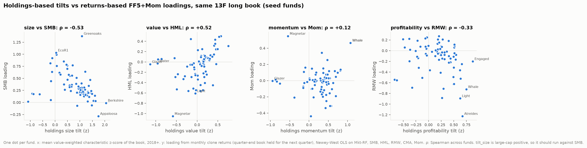

# Returns-based factor regressions vs holdings-based tilts

Generated by `uv run python -m src.models.factor_regressions`. Method and caveats in the module
docstring and `docs/decisions.md`. Return series: the 13F long book of quarter q held from the quarter-end
close through quarter q+1 (the "clone"); monthly excess returns regressed on FF5 + momentum with Newey-West
t-stats (3 lags). Months with less than 60% of the starting book priced are dropped
(252 of 8,958 fund-months); funds need 36+ months.

Stocks Yahoo doesn't price (acquired or delisted since) enter with the filled quarterly label
(13F-implied or delisting return, `src.securities.labels`), spread evenly over the quarter's three
months. On Yahoo prices alone 7,017 fund-months and 79 funds pass; with the fill,
8,706 fund-months and 93 funds.

## Funds that failed coverage on Yahoo prices alone

| fund_name | cohort | months_yahoo | months_filled | median_cov_yahoo | median_cov_filled | alpha_ann | b_Mkt_RF | b_SMB | b_HML | b_RMW | b_CMA | b_Mom | r2 |
|---|---|---|---|---|---|---|---|---|---|---|---|---|---|
| Alpine Associates Management | holdout | 0 | 75 | 0.11 | 0.93 | -0.01 | 0.12 | 0.16 | -0.02 | 0.09 | -0.00 | 0.02 | 0.29 |
| TIG Advisors | holdout | 3 | 78 | 0.10 | 0.88 | -0.02 | 0.18 | 0.14 | -0.07 | 0.08 | -0.03 | 0.00 | 0.38 |
| Baker Bros. Advisors | seed | 33 | 102 | 0.56 | 0.99 | 0.11 | 0.42 | 0.77 | -0.33 | -0.17 | -0.01 | -0.02 | 0.37 |
| Davidson Kempner Capital Management | seed | 0 | 63 | 0.44 | 0.66 | -0.10 | 0.72 | 0.38 | -0.05 | 0.08 | 0.09 | 0.01 | 0.82 |
| Deerfield Management | seed | 9 | 87 | 0.37 | 0.74 | 0.05 | 0.64 | 0.64 | -0.28 | -0.32 | -0.05 | -0.07 | 0.50 |
| Glazer Capital | seed | 0 | 57 | 0.07 | 0.65 | -0.02 | 0.01 | 0.02 | -0.04 | 0.02 | 0.03 | -0.00 | 0.04 |
| HBK Investments | seed | 6 | 48 | 0.25 | 0.59 | -0.17 | 0.44 | 0.44 | 0.07 | -0.00 | -0.45 | -0.21 | 0.47 |
| Magnetar Capital | seed | 18 | 78 | 0.24 | 0.78 | 0.01 | 1.30 | 0.05 | -1.05 | -0.51 | 1.81 | 0.55 | 0.20 |
| Pentwater Capital Management | seed | 3 | 102 | 0.22 | 0.96 | -0.00 | 0.38 | 0.17 | 0.06 | 0.04 | -0.07 | -0.04 | 0.61 |
| Perceptive Advisors | seed | 12 | 102 | 0.41 | 0.97 | 0.04 | 0.57 | 0.81 | -0.29 | -0.69 | -0.12 | 0.03 | 0.53 |
| Sculptor Capital Management | seed | 27 | 87 | 0.53 | 0.73 | 0.00 | 0.74 | 0.24 | -0.05 | -0.17 | -0.02 | -0.01 | 0.83 |
| Soros Fund Management | seed | 33 | 84 | 0.53 | 0.74 | -0.06 | 0.82 | 0.36 | -0.14 | -0.06 | -0.19 | -0.02 | 0.78 |
| Water Island Capital | seed | 0 | 99 | 0.11 | 0.88 | 0.00 | 0.14 | 0.18 | -0.03 | 0.09 | 0.04 | 0.01 | 0.36 |
| Westchester Capital Management | seed | 0 | 96 | 0.15 | 0.85 | -0.01 | 0.21 | 0.17 | 0.05 | 0.19 | -0.07 | -0.01 | 0.47 |

## Do the two methods agree?

Seed funds (77):

| holdings tilt | factor loading | expected sign | spearman | same sign share | funds |
|---|---|---|---|---|---|
| tilt_size | b_SMB | − | -0.53 | 0.17 | 77 |
| tilt_value | b_HML | + | 0.52 | 0.69 | 77 |
| tilt_momentum | b_Mom | + | 0.12 | 0.53 | 77 |
| tilt_profitability | b_RMW | + | -0.33 | 0.32 | 77 |

Seed and holdout funds (93):

| holdings tilt | factor loading | expected sign | spearman | same sign share | funds |
|---|---|---|---|---|---|
| tilt_size | b_SMB | − | -0.48 | 0.18 | 93 |
| tilt_value | b_HML | + | 0.51 | 0.69 | 93 |
| tilt_momentum | b_Mom | + | 0.12 | 0.52 | 93 |
| tilt_profitability | b_RMW | + | -0.30 | 0.33 | 93 |

`same sign share`: funds where the tilt and the loading point the same way (after flipping size).

## Median loadings by style (seed funds, v2 labels)

| style | funds | alpha_ann | b_Mkt_RF | b_SMB | b_HML | b_RMW | b_CMA | b_Mom | r2 |
|---|---|---|---|---|---|---|---|---|---|
| activist | 15 | -0.01 | 0.89 | 0.25 | 0.09 | -0.01 | 0.13 | -0.05 | 0.74 |
| discretionary_other | 3 | -0.01 | 0.82 | 0.19 | -0.09 | -0.11 | -0.19 | 0.07 | 0.80 |
| event_driven | 12 | 0.00 | 0.67 | 0.22 | -0.04 | 0.05 | 0.04 | -0.01 | 0.51 |
| growth_tech | 18 | 0.01 | 1.07 | 0.25 | -0.31 | -0.34 | -0.20 | -0.02 | 0.83 |
| healthcare | 8 | 0.04 | 0.55 | 0.76 | -0.29 | -0.39 | -0.11 | 0.05 | 0.49 |
| multi_manager | 7 | 0.00 | 0.90 | 0.29 | 0.05 | -0.05 | 0.04 | 0.01 | 0.96 |
| quant | 5 | 0.00 | 0.95 | 0.16 | 0.01 | -0.08 | 0.10 | 0.03 | 0.98 |
| value_concentrated | 9 | 0.01 | 1.00 | 0.40 | 0.24 | 0.01 | -0.17 | -0.10 | 0.73 |

## Per fund

`alpha_ann`: annualised intercept of the clone (not the fund's alpha: no shorts, fees, or intra-quarter
trading). Tilt columns: mean holdings z-scores over the same books.

| fund_name | cohort | style | n_months | alpha_ann | t_alpha | b_Mkt_RF | b_SMB | b_HML | b_RMW | b_CMA | b_Mom | r2 | tilt_size | tilt_value | tilt_momentum | tilt_profitability |
|---|---|---|---|---|---|---|---|---|---|---|---|---|---|---|---|---|
| Engine Capital Management | holdout | activist | 77 | 0.13 | 3.10 | 0.75 | 0.71 | 0.03 | 0.50 | 0.25 | -0.22 | 0.75 | 0.50 | 0.15 | 0.03 | 0.19 |
| Impactive Capital | holdout | activist | 77 | 0.03 | 0.50 | 0.88 | 0.72 | 0.16 | 0.14 | 0.31 | -0.14 | 0.73 | 0.63 | 0.33 | 0.14 | 0.49 |
| Element Capital Management | holdout | discretionary_other | 71 | -0.09 | -1.80 | 0.67 | 0.19 | -0.03 | -0.06 | 0.33 | 0.08 | 0.47 | 1.24 | 0.15 | 0.39 | 0.18 |
| Moore Capital Management | holdout | discretionary_other | 77 | 0.03 | 1.30 | 0.79 | 0.21 | 0.05 | -0.18 | -0.13 | 0.10 | 0.88 | 0.88 | -0.01 | 0.34 | 0.05 |
| Alpine Associates Management | holdout | event_driven | 75 | -0.01 | -0.50 | 0.12 | 0.16 | -0.02 | 0.09 | -0.00 | 0.02 | 0.29 | -0.94 | -1.02 | -0.89 | -0.02 |
| TIG Advisors | holdout | event_driven | 77 | -0.02 | -0.80 | 0.18 | 0.14 | -0.07 | 0.08 | -0.03 | 0.00 | 0.38 | -0.90 | -1.00 | -0.87 | 0.04 |
| Alkeon Capital Management | holdout | growth_tech | 77 | 0.03 | 0.90 | 1.03 | 0.15 | -0.26 | -0.22 | -0.15 | 0.05 | 0.82 | 1.47 | 0.08 | 0.59 | 0.61 |
| Jericho Capital Asset Management | holdout | growth_tech | 77 | 0.16 | 2.70 | 1.00 | 0.23 | -0.37 | -0.64 | -0.23 | -0.03 | 0.71 | 0.98 | -0.16 | 0.59 | 0.49 |
| Cormorant Asset Management | holdout | healthcare | 77 | 0.12 | 1.00 | 0.22 | 1.37 | -0.69 | -0.46 | 0.06 | -0.14 | 0.44 | -0.08 | -0.31 | 0.34 | -0.68 |
| Rock Springs Capital Management | holdout | healthcare | 77 | 0.03 | 0.50 | 0.60 | 0.63 | -0.33 | -0.51 | 0.14 | 0.03 | 0.62 | 0.66 | -0.16 | 0.29 | 0.22 |
| Hudson Bay Capital Management | holdout | multi_manager | 62 | 0.04 | 2.00 | 0.70 | 0.02 | -0.11 | -0.24 | -0.04 | -0.02 | 0.88 | 0.94 | -0.18 | 0.23 | 0.30 |
| Verition Fund Management | holdout | multi_manager | 74 | -0.02 | -0.80 | 0.74 | 0.23 | 0.07 | 0.03 | 0.02 | 0.06 | 0.88 | 1.02 | 0.16 | 0.28 | 0.23 |
| PDT Partners | holdout | quant | 77 | 0.04 | 1.60 | 0.93 | 0.64 | -0.09 | -0.05 | 0.02 | 0.05 | 0.94 | 0.69 | 0.07 | 0.41 | 0.38 |
| Qube Research & Technologies | holdout | quant | 77 | -0.00 | -0.10 | 0.85 | 0.14 | 0.07 | -0.03 | 0.11 | 0.00 | 0.94 | 1.28 | 0.19 | 0.49 | 0.40 |
| Dalal Street (Mohnish Pabrai) | holdout | value_concentrated | 77 | 0.09 | 0.60 | 0.72 | 0.57 | 0.01 | -0.34 | -0.13 | -0.74 | 0.34 | 0.96 | 0.71 | 0.32 | -0.13 |
| Punch Card Management | holdout | value_concentrated | 77 | -0.01 | -0.20 | 0.89 | 0.23 | 0.45 | 0.24 | -0.11 | -0.25 | 0.63 | -0.22 | -0.23 | 0.47 | -0.42 |
| Ancora Advisors | seed | activist | 101 | -0.02 | -2.50 | 0.83 | 0.25 | 0.09 | 0.18 | 0.09 | 0.01 | 0.96 | 1.10 | 0.23 | 0.33 | 0.40 |
| Corvex Management | seed | activist | 101 | -0.00 | -0.00 | 1.10 | 0.22 | 0.35 | -0.09 | -0.28 | -0.14 | 0.80 | 1.12 | 0.44 | 0.29 | -0.04 |
| Elliott Investment Management | seed | activist | 101 | 0.09 | 2.00 | 0.74 | 0.21 | 0.25 | 0.23 | 0.30 | -0.17 | 0.62 | 0.88 | 0.12 | 0.33 | -0.07 |
| Engaged Capital | seed | activist | 101 | -0.09 | -1.40 | 0.89 | 0.79 | -0.45 | -0.20 | 0.46 | -0.21 | 0.54 | 0.45 | 0.38 | 0.12 | 0.88 |
| Icahn Capital | seed | activist | 101 | -0.08 | -1.10 | 0.86 | 0.39 | 0.44 | -0.11 | 0.46 | -0.20 | 0.42 | 0.85 | -0.15 | 0.36 | -0.23 |
| Jana Partners | seed | activist | 101 | -0.01 | -0.30 | 0.86 | 0.27 | 0.01 | 0.03 | 0.32 | -0.03 | 0.70 | 0.39 | 0.04 | -0.12 | 0.23 |
| Land & Buildings Investment Management | seed | activist | 101 | -0.01 | -0.20 | 0.77 | 0.33 | 0.06 | 0.21 | 0.06 | 0.01 | 0.74 | 0.66 | 0.16 | 0.10 | -0.50 |
| Legion Partners | seed | activist | 101 | -0.01 | -0.30 | 0.94 | 0.92 | -0.09 | -0.05 | 0.23 | 0.11 | 0.64 | -0.12 | -0.24 | -0.13 | 0.51 |
| Mantle Ridge | seed | activist | 99 | -0.12 | -1.10 | 1.18 | 0.47 | 0.31 | 0.15 | 0.15 | -0.31 | 0.45 | 1.42 | 0.76 | 0.54 | 0.21 |
| Pershing Square Capital Management | seed | activist | 101 | 0.01 | 0.30 | 0.97 | 0.13 | -0.10 | 0.27 | -0.05 | -0.02 | 0.79 | 1.16 | -0.07 | 0.49 | 0.21 |
| Sachem Head Capital Management | seed | activist | 101 | 0.01 | 0.20 | 1.13 | 0.16 | 0.15 | -0.16 | -0.02 | 0.10 | 0.74 | 1.01 | 0.41 | 0.37 | 0.32 |
| Starboard Value | seed | activist | 101 | 0.01 | 0.50 | 0.79 | 0.32 | 0.09 | 0.07 | 0.13 | -0.05 | 0.75 | 0.58 | 0.09 | 0.15 | 0.26 |
| Third Point | seed | activist | 101 | -0.01 | -0.30 | 0.89 | 0.21 | 0.05 | -0.08 | -0.10 | 0.25 | 0.75 | 1.31 | 0.16 | 0.48 | 0.24 |
| Trian Fund Management | seed | activist | 101 | 0.01 | 0.30 | 0.82 | -0.07 | 0.02 | -0.01 | 0.42 | -0.10 | 0.71 | 0.89 | 0.03 | 0.07 | 0.17 |
| ValueAct Capital | seed | activist | 101 | -0.02 | -0.50 | 1.07 | 0.02 | 0.32 | -0.02 | -0.21 | -0.34 | 0.80 | 1.31 | 0.41 | 0.42 | 0.07 |
| Bridgewater Associates | seed | discretionary_other | 101 | -0.01 | -0.70 | 0.82 | -0.06 | 0.12 | -0.11 | 0.04 | 0.07 | 0.83 | 1.48 | 0.19 | 0.48 | 0.49 |
| Duquesne Family Office | seed | discretionary_other | 101 | 0.10 | 3.10 | 1.01 | 0.19 | -0.09 | -0.21 | -0.26 | 0.12 | 0.80 | 1.45 | 0.17 | 0.81 | 0.43 |
| Soros Fund Management | seed | discretionary_other | 83 | -0.06 | -1.60 | 0.82 | 0.36 | -0.14 | -0.06 | -0.19 | -0.02 | 0.78 | 0.58 | -0.07 | -0.05 | -0.06 |
| Canyon Capital Advisors | seed | event_driven | 101 | 0.00 | 0.00 | 0.86 | 0.62 | 0.23 | 0.22 | 0.05 | -0.09 | 0.76 | 0.18 | 0.02 | -0.15 | -0.38 |
| Davidson Kempner Capital Management | seed | event_driven | 63 | -0.10 | -2.50 | 0.72 | 0.38 | -0.05 | 0.08 | 0.09 | 0.01 | 0.82 | 0.36 | -0.12 | 0.02 | -0.06 |
| Farallon Capital Management | seed | event_driven | 101 | 0.01 | 0.40 | 0.81 | 0.21 | -0.08 | -0.08 | -0.03 | -0.02 | 0.82 | 1.07 | 0.11 | 0.34 | 0.24 |
| Glazer Capital | seed | event_driven | 57 | -0.02 | -1.70 | 0.01 | 0.02 | -0.04 | 0.02 | 0.03 | -0.00 | 0.04 | -1.09 | -1.14 | -0.95 | -0.37 |
| HBK Investments | seed | event_driven | 48 | -0.17 | -1.90 | 0.44 | 0.44 | 0.07 | -0.00 | -0.45 | -0.21 | 0.47 | -0.16 | -0.55 | -0.38 | -0.26 |
| Magnetar Capital | seed | event_driven | 77 | 0.01 | 0.10 | 1.30 | 0.05 | -1.05 | -0.51 | 1.81 | 0.55 | 0.20 | -0.17 | -0.59 | -0.55 | -0.13 |
| Pentwater Capital Management | seed | event_driven | 101 | -0.00 | -0.10 | 0.38 | 0.17 | 0.06 | 0.04 | -0.07 | -0.04 | 0.61 | -0.62 | -0.86 | -0.76 | -0.05 |
| Sculptor Capital Management | seed | event_driven | 86 | 0.00 | 0.10 | 0.74 | 0.24 | -0.05 | -0.17 | -0.02 | -0.01 | 0.83 | 0.63 | -0.16 | 0.14 | 0.21 |
| Taconic Capital Advisors | seed | event_driven | 98 | 0.03 | 0.70 | 0.62 | 0.58 | -0.03 | 0.07 | 0.24 | 0.16 | 0.54 | 0.21 | -0.08 | -0.10 | -0.16 |
| Water Island Capital | seed | event_driven | 99 | 0.00 | 0.10 | 0.14 | 0.18 | -0.03 | 0.09 | 0.04 | 0.01 | 0.36 | -0.92 | -0.96 | -0.87 | -0.00 |
| Westchester Capital Management | seed | event_driven | 96 | -0.01 | -0.60 | 0.21 | 0.17 | 0.05 | 0.19 | -0.07 | -0.01 | 0.47 | -0.87 | -0.95 | -0.83 | -0.22 |
| York Capital Management | seed | event_driven | 93 | -0.08 | -0.60 | 1.18 | 0.85 | -0.26 | 0.06 | 0.06 | 0.34 | 0.19 | 0.35 | -0.04 | 0.33 | -0.47 |
| Altimeter Capital Management | seed | growth_tech | 101 | -0.01 | -0.20 | 1.15 | 0.03 | -0.29 | -0.62 | -0.52 | -0.17 | 0.70 | 1.63 | 0.17 | 0.44 | 0.50 |
| Atreides Management | seed | growth_tech | 80 | 0.17 | 3.30 | 1.40 | 0.27 | -0.45 | -1.23 | -0.06 | -0.05 | 0.83 | 1.20 | 0.08 | 0.46 | 0.67 |
| Coatue Management | seed | growth_tech | 101 | 0.01 | 0.40 | 1.20 | 0.24 | -0.56 | -0.49 | -0.26 | 0.10 | 0.83 | 1.45 | 0.08 | 0.74 | 0.49 |
| D1 Capital Partners | seed | growth_tech | 92 | 0.01 | 0.20 | 1.04 | 0.20 | -0.22 | -0.63 | -0.24 | -0.12 | 0.75 | 1.33 | 0.15 | 0.39 | 0.49 |
| Dragoneer Investment Group | seed | growth_tech | 101 | -0.05 | -0.80 | 1.03 | 0.56 | -0.56 | -0.88 | -0.37 | -0.10 | 0.71 | 0.68 | -0.21 | 0.08 | 0.27 |
| Durable Capital Partners | seed | growth_tech | 80 | -0.08 | -2.00 | 1.08 | 0.51 | -0.23 | -0.08 | -0.12 | 0.15 | 0.82 | 0.86 | -0.05 | 0.37 | 0.32 |
| Egerton Capital | seed | growth_tech | 101 | -0.01 | -0.50 | 0.98 | 0.03 | 0.03 | 0.21 | -0.17 | 0.12 | 0.91 | 1.55 | 0.14 | 0.67 | 0.19 |
| Glenview Capital Management | seed | growth_tech | 101 | 0.03 | 1.20 | 1.07 | 0.31 | 0.13 | -0.10 | 0.32 | -0.08 | 0.84 | 1.17 | 0.32 | 0.33 | 0.13 |
| Greenoaks Capital | seed | growth_tech | 68 | 0.14 | 0.90 | 1.36 | 1.38 | -0.55 | -0.32 | -0.63 | -0.19 | 0.44 | 1.08 | 0.14 | 0.69 | 0.50 |
| Hound Partners | seed | growth_tech | 101 | -0.04 | -1.20 | 1.18 | 0.21 | -0.05 | -0.07 | 0.14 | -0.15 | 0.83 | 1.15 | 0.16 | 0.35 | 0.31 |
| Light Street Capital | seed | growth_tech | 101 | 0.05 | 1.20 | 1.20 | 0.33 | -0.61 | -0.89 | -0.31 | 0.03 | 0.85 | 0.94 | -0.04 | 0.45 | 0.62 |
| Lone Pine Capital | seed | growth_tech | 101 | -0.01 | -0.30 | 1.13 | 0.18 | -0.27 | -0.37 | -0.17 | 0.14 | 0.81 | 1.48 | 0.01 | 0.82 | 0.62 |
| Maverick Capital | seed | growth_tech | 101 | 0.02 | 0.50 | 0.99 | 0.64 | -0.41 | -0.22 | 0.26 | -0.01 | 0.64 | 1.22 | 0.18 | 0.37 | 0.40 |
| Steadfast Capital Management | seed | growth_tech | 101 | -0.01 | -0.30 | 1.01 | 0.22 | -0.04 | 0.09 | -0.11 | 0.07 | 0.85 | 1.32 | 0.07 | 0.49 | 0.52 |
| Tiger Global Management | seed | growth_tech | 101 | 0.01 | 0.20 | 1.01 | 0.11 | -0.54 | -0.25 | -0.35 | -0.03 | 0.77 | 1.39 | -0.03 | 0.63 | 0.66 |
| Tybourne Capital | seed | growth_tech | 93 | 0.12 | 1.30 | 0.99 | 0.21 | -0.34 | -0.71 | -0.53 | -0.25 | 0.62 | 0.98 | 0.02 | 0.45 | 0.29 |
| Viking Global Investors | seed | growth_tech | 101 | 0.01 | 0.30 | 0.88 | 0.35 | -0.18 | -0.03 | -0.02 | -0.02 | 0.86 | 1.36 | 0.21 | 0.44 | 0.32 |
| Whale Rock Capital Management | seed | growth_tech | 101 | 0.12 | 2.70 | 1.35 | 0.31 | -0.51 | -0.72 | -0.37 | 0.47 | 0.86 | 1.07 | -0.09 | 1.08 | 0.75 |
| Avoro Capital Advisors | seed | healthcare | 101 | 0.15 | 2.00 | 0.54 | 0.76 | -0.23 | -0.20 | -0.12 | 0.15 | 0.38 | 0.07 | -0.47 | 0.07 | -0.38 |
| Baker Bros. Advisors | seed | healthcare | 101 | 0.11 | 1.60 | 0.42 | 0.77 | -0.33 | -0.17 | -0.01 | -0.02 | 0.37 | 0.49 | -0.33 | 0.16 | 0.54 |
| Deerfield Management | seed | healthcare | 86 | 0.05 | 0.70 | 0.64 | 0.64 | -0.28 | -0.32 | -0.05 | -0.07 | 0.50 | -0.12 | -0.30 | -0.15 | -0.19 |
| EcoR1 Capital | seed | healthcare | 101 | -0.01 | -0.10 | 0.57 | 1.03 | -0.29 | -0.55 | -0.38 | 0.10 | 0.49 | 0.04 | -0.14 | 0.19 | -0.63 |
| OrbiMed Advisors | seed | healthcare | 101 | 0.02 | 0.30 | 0.52 | 0.70 | -0.29 | -0.37 | 0.04 | 0.01 | 0.50 | 0.49 | -0.13 | 0.16 | 0.03 |
| Perceptive Advisors | seed | healthcare | 101 | 0.04 | 0.50 | 0.57 | 0.81 | -0.29 | -0.69 | -0.12 | 0.03 | 0.53 | -0.19 | -0.53 | 0.01 | -0.33 |
| RA Capital Management | seed | healthcare | 101 | 0.07 | 0.80 | 0.44 | 0.99 | -0.53 | -0.54 | -0.10 | 0.07 | 0.42 | 0.06 | -0.49 | 0.17 | -0.67 |
| Suvretta Capital Management | seed | healthcare | 101 | 0.01 | 0.40 | 0.88 | 0.18 | -0.01 | -0.41 | -0.12 | 0.12 | 0.77 | 1.15 | 0.06 | 0.52 | 0.24 |
| Balyasny Asset Management | seed | multi_manager | 101 | 0.00 | 0.20 | 0.90 | 0.29 | 0.13 | 0.02 | 0.01 | 0.00 | 0.96 | 0.94 | 0.17 | 0.30 | 0.19 |
| Citadel Advisors | seed | multi_manager | 101 | 0.00 | 0.20 | 0.90 | 0.25 | 0.07 | -0.05 | 0.01 | -0.03 | 0.97 | 1.08 | 0.20 | 0.35 | 0.23 |
| ExodusPoint Capital Management | seed | multi_manager | 92 | 0.01 | 0.40 | 0.88 | 0.25 | 0.03 | -0.05 | 0.15 | 0.04 | 0.94 | 1.09 | 0.30 | 0.45 | 0.20 |
| Millennium Management | seed | multi_manager | 101 | 0.00 | 0.40 | 0.89 | 0.26 | 0.05 | -0.03 | 0.06 | 0.01 | 0.97 | 1.02 | 0.17 | 0.36 | 0.27 |
| Point72 Asset Management | seed | multi_manager | 101 | 0.03 | 1.40 | 0.95 | 0.31 | 0.03 | -0.15 | 0.04 | 0.02 | 0.94 | 1.05 | 0.17 | 0.39 | 0.27 |
| Schonfeld Strategic Advisors | seed | multi_manager | 98 | 0.01 | 0.80 | 0.97 | 0.30 | 0.09 | -0.06 | -0.01 | 0.04 | 0.95 | 1.01 | 0.20 | 0.41 | 0.18 |
| Tudor Investment Corp | seed | multi_manager | 101 | -0.01 | -0.60 | 0.85 | 0.37 | -0.01 | -0.08 | 0.07 | -0.00 | 0.96 | 0.68 | 0.04 | 0.19 | 0.23 |
| AQR Capital Management | seed | quant | 101 | -0.01 | -0.70 | 0.88 | 0.12 | 0.06 | 0.12 | 0.10 | 0.03 | 0.98 | 1.37 | 0.31 | 0.51 | 0.51 |
| D. E. Shaw & Co. | seed | quant | 101 | 0.01 | 1.60 | 0.99 | 0.17 | -0.02 | -0.15 | 0.07 | 0.03 | 0.98 | 1.21 | 0.15 | 0.51 | 0.43 |
| Gotham Asset Management | seed | quant | 101 | -0.00 | -0.50 | 0.95 | 0.15 | 0.07 | 0.06 | 0.10 | -0.03 | 0.98 | 1.29 | 0.26 | 0.48 | 0.51 |
| Renaissance Technologies | seed | quant | 101 | 0.02 | 1.90 | 0.84 | 0.22 | -0.01 | -0.08 | 0.10 | 0.03 | 0.95 | 1.01 | 0.16 | 0.54 | 0.54 |
| Two Sigma Investments | seed | quant | 101 | 0.00 | 0.40 | 0.96 | 0.16 | 0.01 | -0.10 | 0.12 | -0.04 | 0.97 | 1.22 | 0.15 | 0.51 | 0.40 |
| Abrams Capital Management | seed | value_concentrated | 101 | 0.02 | 0.40 | 0.92 | 0.40 | 0.24 | -0.15 | -0.18 | -0.11 | 0.65 | 1.06 | 0.46 | 0.32 | 0.43 |
| Appaloosa Management | seed | value_concentrated | 101 | 0.03 | 0.70 | 1.21 | -0.28 | 0.25 | -0.52 | -0.17 | 0.05 | 0.77 | 1.74 | 0.50 | 0.69 | 0.63 |
| Baupost Group | seed | value_concentrated | 101 | -0.04 | -1.10 | 0.75 | 0.56 | 0.12 | 0.13 | 0.02 | -0.03 | 0.73 | 0.60 | 0.10 | -0.12 | 0.18 |
| Berkshire Hathaway | seed | value_concentrated | 101 | -0.00 | -0.10 | 1.00 | -0.01 | 0.10 | 0.21 | 0.11 | -0.10 | 0.84 | 2.05 | 0.37 | 0.59 | 0.28 |
| Brave Warrior Advisors | seed | value_concentrated | 101 | 0.01 | 0.30 | 1.08 | 0.19 | 0.50 | 0.08 | -0.21 | 0.07 | 0.84 | 1.29 | 0.58 | 0.44 | 0.25 |
| Fairholme Capital Management | seed | value_concentrated | 101 | 0.08 | 0.90 | 0.98 | 0.77 | -0.04 | -0.14 | 0.33 | -0.31 | 0.52 | 0.70 | 0.46 | 0.57 | -0.21 |
| Greenlight Capital | seed | value_concentrated | 101 | 0.00 | 0.10 | 1.10 | 0.47 | 0.49 | 0.25 | -0.32 | 0.03 | 0.80 | 0.50 | 0.53 | 0.29 | -0.03 |
| Himalaya Capital Management | seed | value_concentrated | 89 | -0.03 | -0.60 | 1.01 | 0.14 | 0.43 | 0.01 | -0.43 | -0.16 | 0.71 | 1.61 | 0.44 | 0.53 | 0.14 |
| Scion Asset Management | seed | value_concentrated | 84 | 0.21 | 2.20 | 0.90 | 0.58 | -0.24 | -0.02 | 1.28 | -0.44 | 0.53 | 0.54 | 0.23 | 0.05 | 0.36 |
