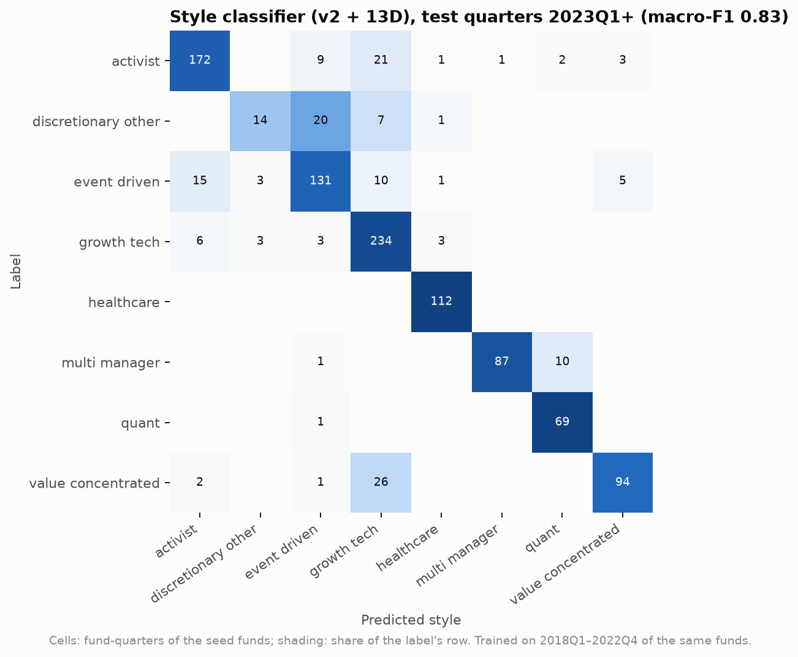
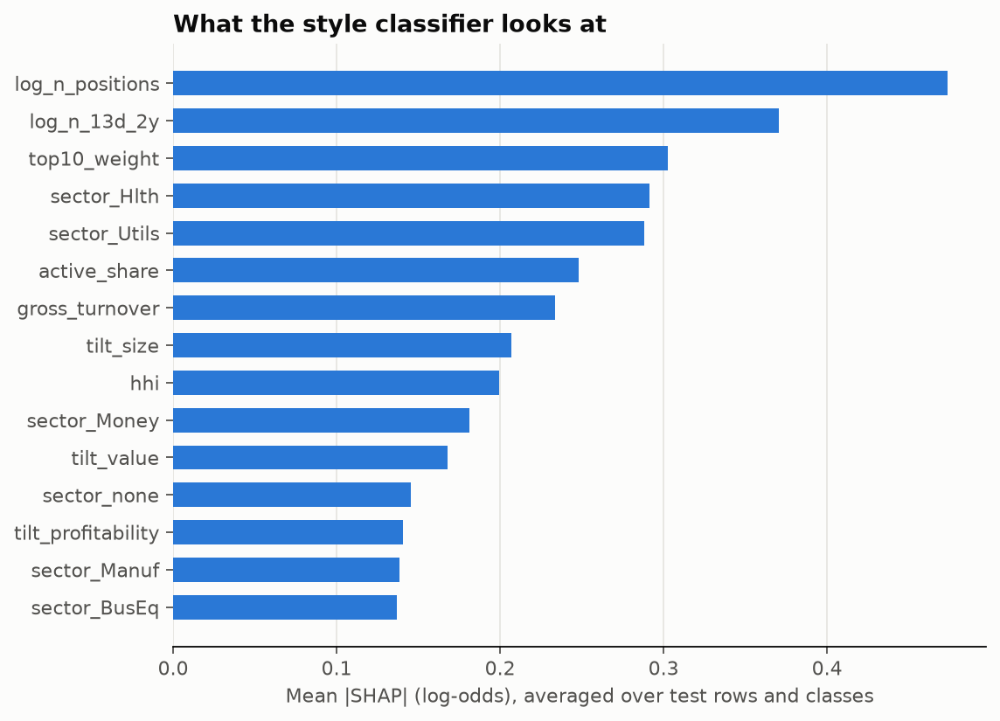

# Style classifier results

Generated by `uv run python -m src.models.style_classifier`. Features: `fund_fingerprint`
(+ `activist_13d` for the 13D variant). Trained on seed funds 2018Q1–2022Q4;
tested on 2023Q1+. Hyperparameters fixed, not tuned. v2 labels apply the high- and
medium-confidence corrections in `data/reference/style_labels_v2.csv`.

## v1 vs v2 vs holdout

| evaluation | n | v1 macro-F1 | v2 macro-F1 | v2 + 13D macro-F1 | v1 acc | v2 acc | v2 + 13D acc |
|---|---|---|---|---|---|---|---|
| time split | 1068 | 0.77 | 0.79 | 0.83 | 0.79 | 0.82 | 0.85 |
| time split, by fund | 77 | 0.81 | 0.84 | 0.86 | 0.84 | 0.87 | 0.90 |
| funds held out | 1068 | 0.57 | 0.58 | 0.61 | 0.58 | 0.60 | 0.66 |
| funds held out, by fund | 77 | 0.61 | 0.62 | 0.64 | 0.64 | 0.65 | 0.70 |
| holdout | 224 | 0.56 | 0.57 | 0.58 | 0.60 | 0.64 | 0.63 |
| holdout, by fund | 16 | 0.48 | 0.55 | 0.59 | 0.56 | 0.62 | 0.62 |

- **time split**: same seed funds, later years (scored against that variant's labels).
- **funds held out**: 5 folds over seed funds; the honest number for an unseen fund among the seed funds.
- **holdout**: 16 hand-labelled funds outside the seed list, 2 per style, scored once with a model trained on all
  seed funds; the only evaluation not influenced by the label review.
- "by fund" = majority vote over a fund's quarters. Majority-class baseline (time split, v2 + 13D labels):
  macro-F1 0.05, accuracy 0.23.

**Caveat:** v2 corrected labels after looking at where the v1 model disagreed, so v2's seed-fund scores
(time split, funds held out) are optimistic by construction. Compare label sets on the holdout only.

Final model (figures, `style_predictions`): **v2 + 13D**, chosen by funds-held-out macro-F1 (seed funds only).

## Holdout funds (v2 + 13D)

| fund_name | label | predicted | share_of_quarters | quarters |
|---|---|---|---|---|
| Engine Capital Management | activist | growth_tech | 1.00 | 14 |
| Impactive Capital | activist | activist | 1.00 | 14 |
| Element Capital Management | discretionary_other | event_driven | 0.36 | 14 |
| Moore Capital Management | discretionary_other | multi_manager | 0.86 | 14 |
| Alpine Associates Management | event_driven | event_driven | 1.00 | 14 |
| TIG Advisors | event_driven | event_driven | 1.00 | 14 |
| Alkeon Capital Management | growth_tech | growth_tech | 1.00 | 14 |
| Jericho Capital Asset Management | growth_tech | growth_tech | 1.00 | 14 |
| Cormorant Asset Management | healthcare | healthcare | 1.00 | 14 |
| Rock Springs Capital Management | healthcare | healthcare | 1.00 | 14 |
| Hudson Bay Capital Management | multi_manager | event_driven | 0.57 | 14 |
| Verition Fund Management | multi_manager | multi_manager | 1.00 | 14 |
| PDT Partners | quant | quant | 0.79 | 14 |
| Qube Research & Technologies | quant | multi_manager | 0.86 | 14 |
| Dalal Street (Mohnish Pabrai) | value_concentrated | value_concentrated | 0.57 | 14 |
| Punch Card Management | value_concentrated | activist | 0.50 | 14 |

## Top features (mean |SHAP|, seed test rows, v2 + 13D)

| feature | mean_abs_shap |
|---|---|
| log_n_positions | 0.47 |
| log_n_13d_2y | 0.37 |
| top10_weight | 0.30 |
| sector_Hlth | 0.29 |
| sector_Utils | 0.29 |
| active_share | 0.25 |
| gross_turnover | 0.23 |
| tilt_size | 0.21 |
| hhi | 0.20 |
| sector_Money | 0.18 |
| tilt_value | 0.17 |
| sector_none | 0.15 |
| tilt_profitability | 0.14 |
| sector_Manuf | 0.14 |
| sector_BusEq | 0.14 |

## Seed funds whose predicted style still disagrees with the label (v2 + 13D, test quarters)

`why` = the three features with the largest mean SHAP toward the predicted style.

| fund_name | label | predicted | share_of_quarters | quarters | why |
|---|---|---|---|---|---|
| Appaloosa Management | value_concentrated | growth_tech | 0.93 | 14 | sector_BusEq (+0.65), tilt_profitability (+0.63), log_n_positions (+0.61) |
| Soros Fund Management | discretionary_other | event_driven | 0.86 | 14 | sector_none (+2.11), sector_Utils (+0.48), top10_weight (+0.45) |
| ValueAct Capital | activist | growth_tech | 0.86 | 14 | sector_BusEq (+1.12), log_n_13d_2y (+0.78), sector_Utils (+0.68) |
| Farallon Capital Management | event_driven | growth_tech | 0.71 | 14 | tilt_size (+0.53), hhi (+0.29), sector_Utils (+0.28) |
| Millennium Management | multi_manager | quant | 0.71 | 14 | top10_weight (+2.48), log_n_positions (+1.98), hhi (+1.00) |
| Canyon Capital Advisors | event_driven | activist | 0.64 | 14 | log_n_positions (+1.09), hhi (+0.67), top10_weight (+0.49) |
| Ancora Advisors | activist | event_driven | 0.57 | 14 | sector_none (+0.73), top10_weight (+0.43), sector_Manuf (+0.36) |
| Duquesne Family Office | discretionary_other | growth_tech | 0.50 | 14 | log_n_positions (+0.42), top10_weight (+0.39), log_n_13d_2y (+0.31) |
