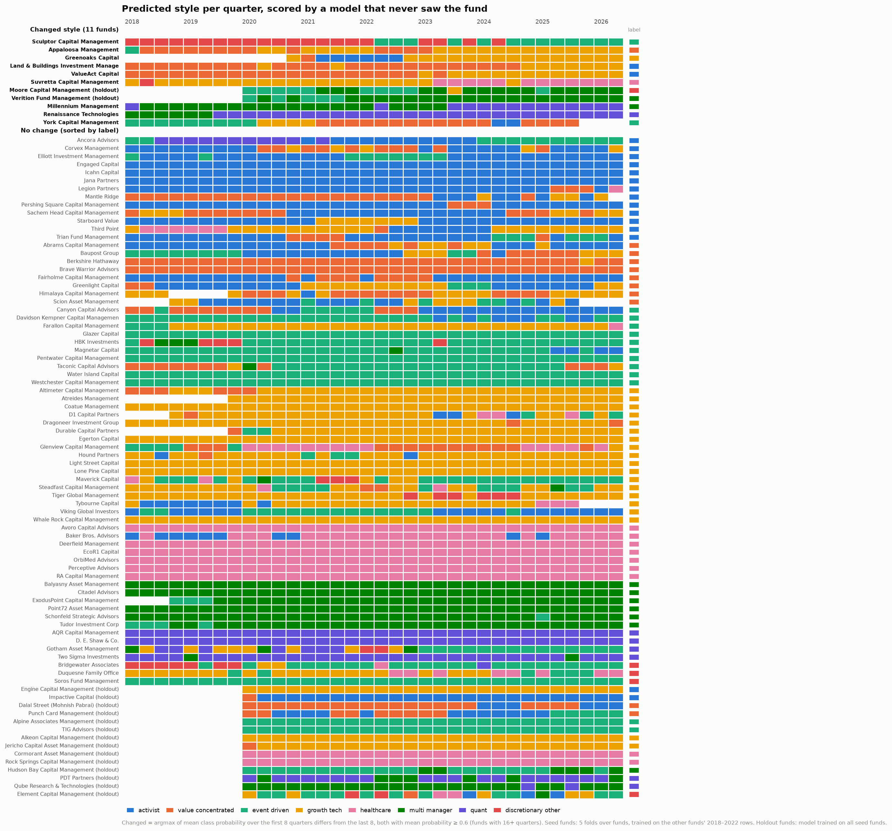
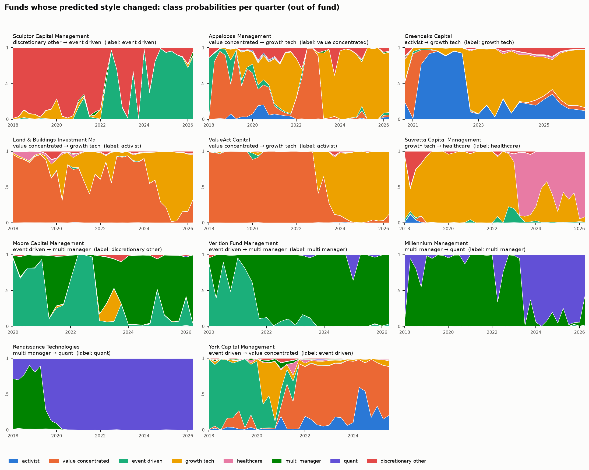

# Style drift

Generated by `uv run python -m src.models.style_drift` (model variant: v2 + 13D). Every quarter is scored by a
model that never saw the fund (method in the module docstring). Changed = the argmax of the mean class probability
over a fund's first 8 quarters differs from its last 8, and both winning mean probabilities are at
least 0.6; funds need 16+ quarters.
`p_early` / `p_late`: the winning mean probability in each window. `stability`: share of quarters predicted as the
fund's most common style. `switches`: quarter-to-quarter changes of the top prediction.

11 of 93 funds changed (93 had enough
quarters). Median stability: 0.82.

Sensitivity to the confidence threshold (funds flagged): 0.0: 33, 0.5: 23, 0.6: 11, 0.7: 4.

## Funds that changed

| fund_name | cohort | label | first_quarter | early_style | p_early | late_style | p_late | stability | switches |
|---|---|---|---|---|---|---|---|---|---|
| Sculptor Capital Management | seed | event_driven | 2018Q1 | discretionary_other | 0.92 | event_driven | 0.88 | 0.62 | 7 |
| Appaloosa Management | seed | value_concentrated | 2018Q1 | value_concentrated | 0.64 | growth_tech | 0.88 | 0.59 | 6 |
| Greenoaks Capital | seed | growth_tech | 2020Q4 | activist | 0.71 | growth_tech | 0.65 | 0.70 | 3 |
| Land & Buildings Investment Management | seed | activist | 2018Q1 | value_concentrated | 0.87 | growth_tech | 0.75 | 0.74 | 5 |
| ValueAct Capital | seed | activist | 2018Q1 | value_concentrated | 0.99 | growth_tech | 0.96 | 0.62 | 3 |
| Suvretta Capital Management | seed | healthcare | 2018Q1 | growth_tech | 0.81 | healthcare | 0.69 | 0.62 | 5 |
| Moore Capital Management | holdout | discretionary_other | 2020Q1 | event_driven | 0.60 | multi_manager | 0.82 | 0.58 | 7 |
| Verition Fund Management | holdout | multi_manager | 2020Q1 | event_driven | 0.65 | multi_manager | 0.94 | 0.81 | 5 |
| Millennium Management | seed | multi_manager | 2018Q1 | multi_manager | 0.79 | quant | 0.85 | 0.59 | 4 |
| Renaissance Technologies | seed | quant | 2018Q1 | multi_manager | 0.63 | quant | 1.00 | 0.82 | 1 |
| York Capital Management | seed | event_driven | 2018Q1 | event_driven | 0.84 | value_concentrated | 0.67 | 0.52 | 4 |

## Least stable funds that did not change (top 10 by switches)

| fund_name | cohort | label | first_quarter | early_style | p_early | late_style | p_late | stability | switches |
|---|---|---|---|---|---|---|---|---|---|
| Element Capital Management | holdout | discretionary_other | 2020Q1 | event_driven | 0.54 | growth_tech | 0.27 | 0.46 | 18 |
| Corvex Management | seed | activist | 2018Q1 | activist | 0.92 | activist | 0.62 | 0.56 | 14 |
| Gotham Asset Management | seed | quant | 2018Q1 | growth_tech | 0.32 | event_driven | 0.31 | 0.41 | 14 |
| Scion Asset Management | seed | value_concentrated | 2018Q4 | activist | 0.62 | event_driven | 0.40 | 0.54 | 14 |
| Duquesne Family Office | seed | discretionary_other | 2018Q1 | growth_tech | 0.70 | healthcare | 0.52 | 0.59 | 13 |
| Maverick Capital | seed | growth_tech | 2018Q1 | event_driven | 0.38 | event_driven | 0.61 | 0.68 | 13 |
| Steadfast Capital Management | seed | growth_tech | 2018Q1 | growth_tech | 0.63 | growth_tech | 0.37 | 0.56 | 13 |
| D1 Capital Partners | seed | growth_tech | 2018Q4 | growth_tech | 0.85 | growth_tech | 0.37 | 0.68 | 12 |
| Hound Partners | seed | growth_tech | 2018Q1 | growth_tech | 0.50 | growth_tech | 0.97 | 0.82 | 10 |
| Abrams Capital Management | seed | value_concentrated | 2018Q1 | activist | 0.79 | activist | 0.44 | 0.65 | 9 |
